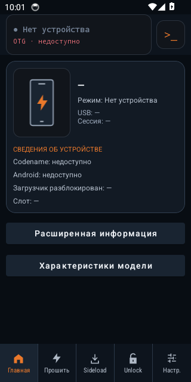
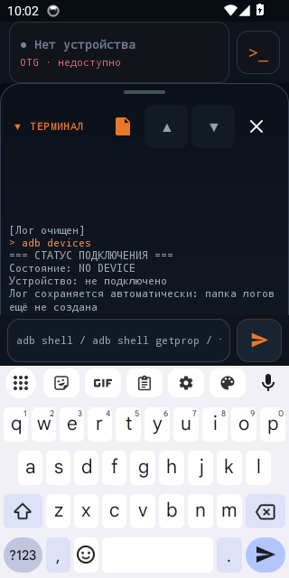
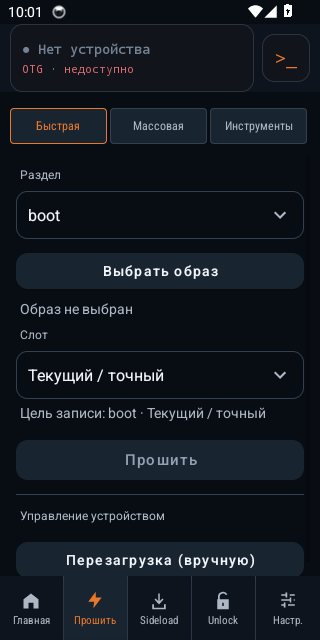
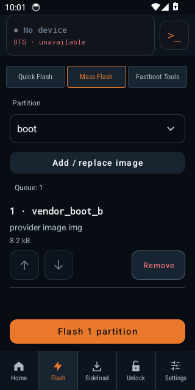
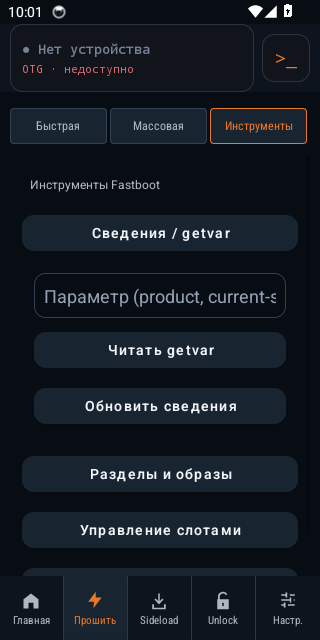
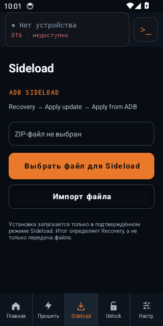

# NekoFlash 2.0

English · [Русский](README_ru.md)

Run ADB and Fastboot from one Android phone to service a second phone over USB OTG. The host needs Android 8.0+ and USB Host support. Use a data-capable cable. Root is optional on the host.

**Hardware beta testing · REV45**

We are collecting HOST → TARGET reports for the REV45 development build. The debug app installs alongside the original NekoFlash. Physical OTG, reconnect and partition-write results are still pending for this build.

**[Download the Insiders tester kit (ZIP)](https://github.com/Ncorror/NekoFlash-2.0/releases/download/insiders-rev45/NekoFlash-Insiders-REV45.zip)** · [Official GitHub Actions downloads](https://github.com/Ncorror/NekoFlash-2.0/actions/workflows/build.yml?query=branch%3Amain+is%3Asuccess) · [NekoFlash Insiders · Telegram](https://t.me/+NR_FiUmvXlViOTUy)

Open the ZIP on the **host** phone. Install the included debug APK, then open `testbook.html` in a browser. The kit includes RU/EN instructions, APK and file checksums, and the source archive for the bundled filesystem tools. For a newer CI snapshot, sign in to GitHub, open a successful main run and choose **NekoFlash-Insiders-Tester-Kit** under Artifacts.

[Field guide](docs/insiders/FIELD-GUIDE-EN.md) · [Offline testbook RU/EN](docs/insiders/testbook.html)

For one test round, distribute the same downloaded ZIP to everyone. The previous REV43 and reference REV45 APKs have different debug signing certificates. Back up DEV logs and export testbook progress before replacing a conflicting DEV installation.

## First test

Start with the interface and keyboard. Then connect a second phone, authorize ADB on the target and try `adb devices` and `adb shell getprop ro.product.model`. Record both models, Android versions, build ID and the observed result. Share the report ZIP privately with the test team.

> Flashing, erasing, formatting or unlocking can wipe the target or leave it unable to boot. Test writes only in an agreed lab session with a spare target, a backup and a verified recovery path.

## Inside the app

The console supports ADB shell, push/pull and APK installation. The Flash tab contains Quick Flash, a Mass Flash queue and Fastboot tools. The app also has recovery Sideload, Xiaomi Unlock, operation reports and raw USB diagnostics.

Android 14 emulator (API 34), REV45. Home shows a disconnected host. The Mass Flash queue contains a test image.

| Home | Terminal | Quick Flash |
| --- | --- | --- |
|  |  |  |

| Mass Flash queue | Fastboot tools | ADB Sideload |
| --- | --- | --- |
|  |  |  |

## Build and evidence

Reference APK and gallery — `6.0.0-alpha11-dev` (234), `ru.forum.adbfastboottool.dev`, [`7b54ba1e7080`](https://github.com/Ncorror/NekoFlash-2.0/commit/7b54ba1e70807bdc7cee65a64cff87fd002ce26b). [CI #409](https://github.com/Ncorror/NekoFlash-2.0/actions/runs/41354284165) · [APK ZIP](https://github.com/Ncorror/NekoFlash-2.0/actions/runs/41354284165/artifacts/13102347829).

308 JVM tests passed. Android API 26 and 34 passed 20 instrumentation tests each. Lint reported zero findings. Each new tester kit records its own commit and APK hash in `BUILD.txt`.

[Audit / Аудит](docs/insiders/AUDIT-2026-11-02.md) · [Hardware](docs/HARDWARE_VALIDATION.md) · [USB OTG](docs/USB_CONNECTION_TROUBLESHOOTING.md) · [Privacy](PRIVACY.md)

For a local debug build, use JDK 17 and the repository’s filesystem tool build steps. See the [build workflow](.github/workflows/build.yml).

## Project

Author and maintainer — [Ncorror](https://github.com/Ncorror). Project collaborator — [IQ-HARRY7](https://github.com/IQ-HARRY7).

[Apache 2.0](LICENSE) · [Artwork](ASSETS_LICENSE.md) · [Third-party notices](THIRD_PARTY_NOTICES.md) · [Previous README and release history](https://github.com/Ncorror/NekoFlash-2.0/blob/7b54ba1e70807bdc7cee65a64cff87fd002ce26b/README.md)

Topics — `android` `usb-otg` `usb-host` `adb` `fastboot` `adb-sideload` `android-recovery` `hardware-testing`
