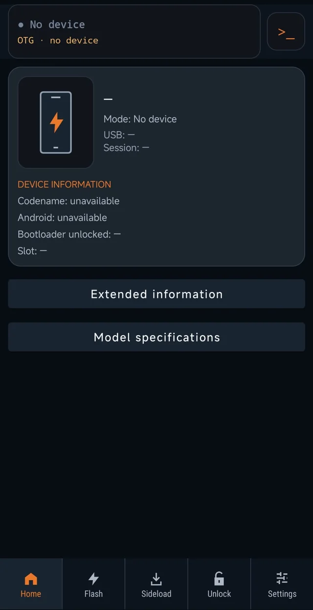
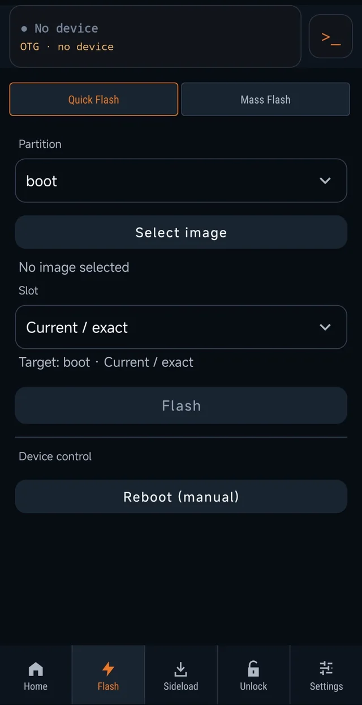
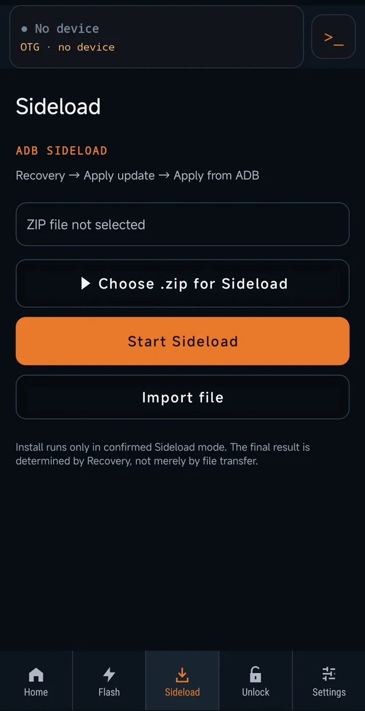

# NekoFlash 2.0

<p align="center"><a href="https://nekoflash.ncorror.chatgpt.site/"></a></p>

<p align="center"><strong>ADB · Fastboot · Recovery · Sideload</strong><br>Use one Android phone to manage another over USB OTG.</p>

<p align="center">
  <a href="https://github.com/Ncorror/NekoFlash-2.0/releases/download/v6.0.0-alpha12/NekoFlash-6.0.0-alpha12.apk"></a>
  <a href="https://github.com/Ncorror/NekoFlash-2.0/releases/download/v6.0.0-alpha12/NekoFlash-6.0.0-alpha12.apk.sha256"></a>
  <a href="https://github.com/Ncorror/NekoFlash-2.0/releases"></a>
</p>
<p align="center">
  <a href="https://nekoflash.ncorror.chatgpt.site/"></a>
  <a href="https://t.me/+NR_FiUmvXlViOTUy"></a>
  <a href="https://nekoflash.ncorror.chatgpt.site/guides/"></a>
</p>

<p align="center">Android 8.0+ · USB Host / OTG · No root required on the host<br><strong>English</strong> · <a href="README_ru.md">Русский</a></p>

**Current signed release:** [6.0.0-alpha12](https://github.com/Ncorror/NekoFlash-2.0/releases/tag/v6.0.0-alpha12) · versionCode **235** · [APK, 4.6 MiB](https://github.com/Ncorror/NekoFlash-2.0/releases/download/v6.0.0-alpha12/NekoFlash-6.0.0-alpha12.apk)

NekoFlash turns an Android phone or tablet into an ADB and Fastboot host. Flash compatible images, send Recovery ZIPs, install APKs, transfer files and run commands directly from your phone. The application keeps complete operation logs and supports the Xiaomi account and bootloader-unlock workflow.

## Connect in three steps

1. **Install the APK on the host phone.** Use the orange download button above and grant installation from your browser or file manager when Android asks.
2. **Connect the target over USB OTG.** Use a data-capable cable or adapter and allow NekoFlash to access the USB device.
3. **Choose the target mode.** For ADB, enable USB debugging and accept its RSA prompt. For Fastboot, boot the target into the bootloader. For Sideload, start ADB Sideload in the target's Recovery.

[Connection help](https://nekoflash.ncorror.chatgpt.site/help/#start) · [Choose a flashing workflow](https://nekoflash.ncorror.chatgpt.site/guides/flash-android-without-pc/)

## What you can do

| Tool | Available operations |
| --- | --- |
| **ADB** | Shell, APK installation, Push/Pull and device diagnostics. |
| **Fastboot** | Quick Flash, a Mass Flash image queue, partition information and direct commands. |
| **Recovery / Sideload** | Select or clear a ZIP, then send it with a separate Start action. |
| **Xiaomi** | Mi Account session management and the bootloader-unlock workflow. |
| **File transfers** | Resume large Pull transfers from durable checkpoints and verify the final SHA-256. |
| **Operation Center** | Inspect operation status and export complete diagnostic evidence. |

Host root is not required. Target operations depend on the device mode, bootloader state and partition layout. NekoFlash supports devices without A/B slots; it does not assume every device uses them.

**Xiaomi unlock status:** Mi Account sign-in and Fastboot detection are verified. Full unlocking after the code rewrite still needs a repeated end-to-end test on a locked device. Xiaomi's account eligibility and waiting periods apply. [Current unlock guide](https://nekoflash.ncorror.chatgpt.site/guides/xiaomi-unlock-without-pc/).

## See the interface

<p align="center">
  <a href="https://nekoflash.ncorror.chatgpt.site/#inside"></a>
  <a href="https://nekoflash.ncorror.chatgpt.site/#inside"></a>
  <a href="https://nekoflash.ncorror.chatgpt.site/#inside"></a>
</p>

Real English-language **development-build (`.dev`)** screenshots; the signed release UI may differ. [Explore all six screens on the website](https://nekoflash.ncorror.chatgpt.site/#inside).

## Guides

- [Flash Android without a PC](https://nekoflash.ncorror.chatgpt.site/guides/flash-android-without-pc/) — choose between a Fastboot image, a Recovery ZIP and custom recovery.
- [ADB from another Android phone](https://nekoflash.ncorror.chatgpt.site/guides/adb-without-pc/) — connect, authorize, use the terminal, install APKs and transfer files.
- [Fastboot from Android](https://nekoflash.ncorror.chatgpt.site/guides/fastboot-from-android/) — detect the target and inspect its partitions before an operation.
- [Install Recovery, TWRP or OrangeFox](https://nekoflash.ncorror.chatgpt.site/guides/flash-recovery-twrp/) — select an image for the exact model and partition layout.
- [Send a ZIP with ADB Sideload](https://nekoflash.ncorror.chatgpt.site/guides/adb-sideload/) — prepare Recovery and start the transfer explicitly.
- [Xiaomi / Redmi / POCO bootloader unlock](https://nekoflash.ncorror.chatgpt.site/guides/xiaomi-unlock-without-pc/) — account requirements and the current verification status.

## Release integrity

Download the public signed APK from [GitHub Releases](https://github.com/Ncorror/NekoFlash-2.0/releases/latest). The **SHA-256** button downloads its checksum file directly.

<details>
<summary>APK checksum and release contents</summary>

SHA-256 of `NekoFlash-6.0.0-alpha12.apk`:

```text
f5013cb895d11f7c42272075eb384e0b0bbc9d1fa3d537321504fbd01499e53b
```

The release contains the signed APK, its `.sha256` file and `filesystem-tools-source.tar.gz`, the required corresponding source for bundled filesystem tools. Actions debug/test artifacts are separate from the signed public release.

</details>

<details>
<summary>Validation and known device cases</summary>

The alpha12 release passed **409 JVM tests**, **29 installed-app tests on each of Android API 26 and 34**, independent ext4/F2FS verification and Android Lint. Physical qualification remains the accepted alpha11 campaign; alpha12 does not claim a new hardware campaign.

- **POCO X3 Pro / vayu:** Fastboot format/wipe and subsequent Android boot — FIELD PASS.
- **X3 Pro host → X3 Pro target:** repeated 128 MiB Pull/Push with matching SHA-256 — FIELD PASS.
- **Recovery/Sideload, Mass Flash, ADB/Fastboot transitions and terminal rotation/input:** accepted field evidence on the documented rigs.
- **POCO F7 / onyx as host:** intermittent long inbound USB transfer failures remain documented; resumable Pull preserves completed checkpoints.
- NekoFlash previously unlocked **POCO X3 Pro, POCO F5 and POCO X7 Pro**. The rewritten unlock path awaits another complete hardware test.

[Current status](docs/STATUS.md) · [Hardware validation](docs/HARDWARE_VALIDATION.md) · [USB troubleshooting](docs/USB_CONNECTION_TROUBLESHOOTING.md)

</details>

## Help, feedback and contributions

Join [Telegram](https://t.me/+NR_FiUmvXlViOTUy) for discussion or [open a GitHub issue](https://github.com/Ncorror/NekoFlash-2.0/issues) with both phone models, Android/firmware versions, the NekoFlash version, reproduction steps and the exact outcome. Include the application's diagnostic ZIP when needed; complete raw logs are retained.

For development and review, start with [the documentation index](docs/README.md) and [the current status](docs/STATUS.md). [Professional recovery policy](docs/PROFESSIONAL_RECOVERY_POLICY.md) · [Security](docs/SECURITY.md) · [Privacy](PRIVACY.md).

Maintained by [Ncorror](https://github.com/Ncorror), with project collaborator [IQ-HARRY7](https://github.com/IQ-HARRY7).

[Apache 2.0](LICENSE) · [Artwork terms](ASSETS_LICENSE.md) · [Third-party notices](THIRD_PARTY_NOTICES.md) · [Changelog](CHANGELOG.md)
