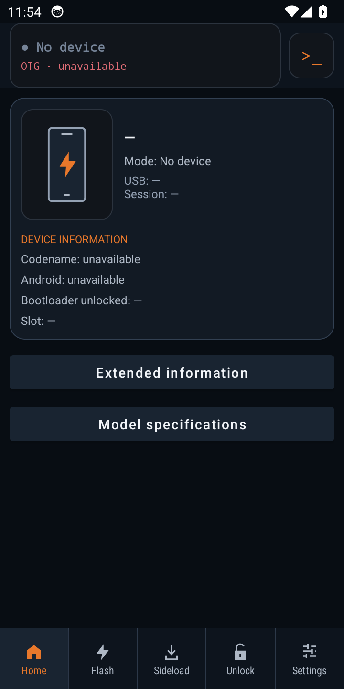
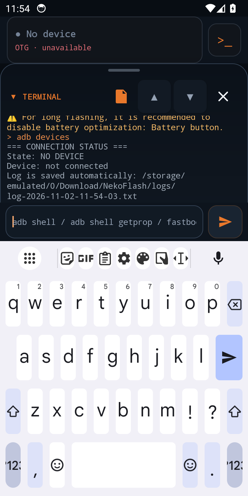
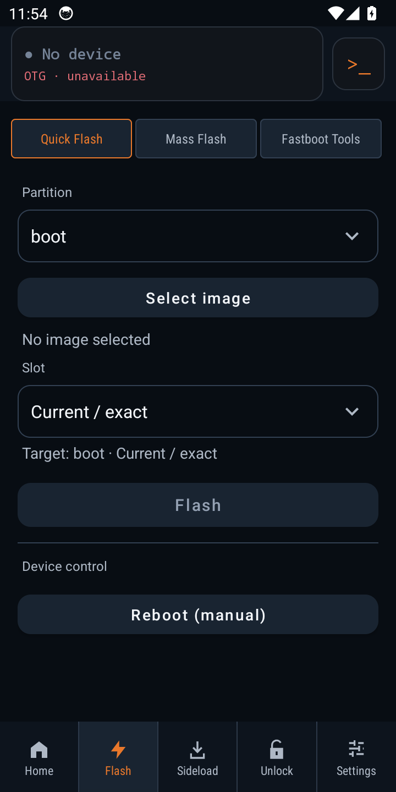
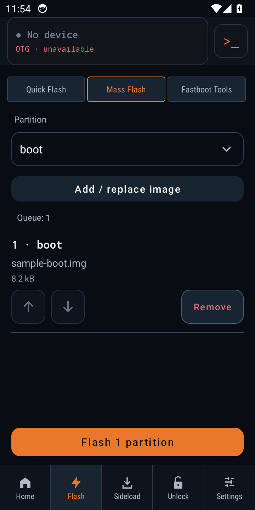
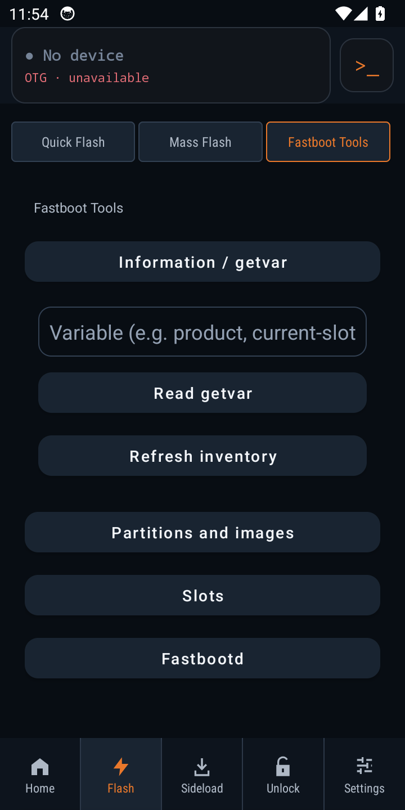
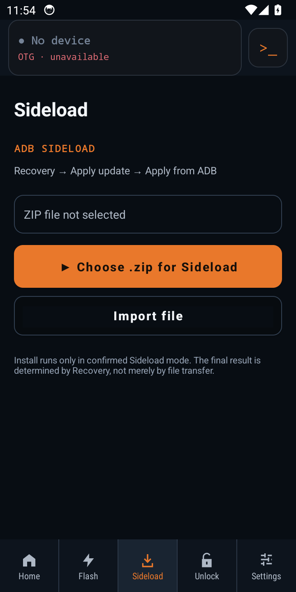

# NekoFlash 2.0

**Current source baseline (8 Nov 2026):** [`main=6a8accd8e33e`](https://github.com/Ncorror/NekoFlash-2.0/commit/6a8accd8e33eef946efa1f18a829b0cc2b797e6e) after merged PR #60 (docs), #61 (read-only diagnostic source-inventory verifier) and #62 (43-case TestBook scenario update). The [PR #62 candidate CI](https://github.com/Ncorror/NekoFlash-2.0/actions/runs/42515445165) passed build/JVM/lint, Android API26/API34 and tester-kit packaging. **Post-merge main CI [#42517047929](https://github.com/Ncorror/NekoFlash-2.0/actions/runs/42517047929) was independently verified SUCCESS**: build, installed Android API26 and API34, tester-kit packaging and pinning jobs passed. Do not confuse this CI pass with physical flashing. This is DEV source, **not a signed new release**.

**Real hardware evidence already exists.** On POCO F7 → **unlocked** POCO X3 Pro Android14, real 128 MiB Recovery flash plus Recovery/Fastbootd were exercised on REV48; separate older alpha10.1 Sideload packages have Recovery-side success. The REV48 OrangeFox 73,757,208-byte ZIP itself remained **VERIFY_PENDING**. On POCO F7 → **another, locked** POCO X3 Pro Android12, REV54 physically passed 1023/1024/1025-byte USB frames, 512-file recursive Push/Pull and 16 MiB round-trip SHA-256. No partition flashing occurred on the locked phone. Older POCO X7 Pro alpha10 all-slot vendor_boot flashes are separately documented.

**9 Nov hardware and Sideload development update (not yet merged):** On the **unlocked A-only vayu**, real **Mass Flash boot/dtbo/recovery 3/3 passed**. Separately, `fastboot format userdata` had Fastboot `OKAY` but Android failed to boot ([#65](https://github.com/Ncorror/NekoFlash-2.0/issues/65)), and `fastboot -w` stopped partway at unresponsive `erase:cache` ([#64](https://github.com/Ncorror/NekoFlash-2.0/issues/64)). The original LineageOS 22.2 ZIP failed official SHA-256 comparison and Recovery rejected its signature; a separate **OrangeFox R11.3 ZIP sideloaded from Lineage Recovery** was followed by a real Recovery switch, but the ZIP installer exit code was not captured. **Do not rerun these destructive tests to fill old checkboxes.** [Full RU/EN 9 Nov results](docs/testing/PHYSICAL-TEST-EVIDENCE-LEDGER-2026-11-08-EN.md).

**Next test-only candidate:** [combined Sideload PR #71](https://github.com/Ncorror/NekoFlash-2.0/pull/71) separates **Choose ZIP** from explicit **Start + confirmation**, retains the SAF selection for retries, and records verified Recovery replacement without inventing installation success. [PR CI #42533760615](https://github.com/Ncorror/NekoFlash-2.0/actions/runs/42533760615) **SUCCESS**: **346 JVM tests, zero lint findings, API 26/34 and tester kit PASS**. **Not merged, not tested on real hardware.** The installed `main` APK **still immediately sends a ZIP when the file picker returns**, so don't mistake its UI for the corrected PR version. No signed production release has been made.

**Before proposing more tests, read the [physical evidence ledger (EN)](docs/testing/PHYSICAL-TEST-EVIDENCE-LEDGER-2026-11-08-EN.md) / [RU](docs/testing/PHYSICAL-TEST-EVIDENCE-LEDGER-2026-11-08-RU.md).** [Reconciliation audit](docs/testing/DOCUMENTATION-AUDIT-2026-11-08-RU.md) identifies stale REV45/55 labels and real remaining gaps: Chrome TestBook export [#49](https://github.com/Ncorror/NekoFlash-2.0/issues/49), missing historical log prologue [#50](https://github.com/Ncorror/NekoFlash-2.0/issues/50), Sideload result lifecycle [#47](https://github.com/Ncorror/NekoFlash-2.0/issues/47) and terminal/device-specific UI regressions. The existing 43 TestBook cards are **not** a list of 43 unperformed hardware tests.

**Tester download:** use a **successful latest `main` GitHub Actions [two-file kit](https://github.com/Ncorror/NekoFlash-2.0/actions/workflows/build.yml?query=branch%3Amain+is%3Asuccess)** containing its exact matching APK and `testbook.html`; verify embedded SHA-256 and run ID, and preserve old DEV diagnostics/progress. The published **REV45** ZIP/screenshots below are *historical*, not the current build. The standalone repository HTML may embed historical reference metadata; only the CI-packaged HTML matches the current APK.

English · [Русский](README_ru.md)

Run ADB and Fastboot from one Android phone to service a second phone over USB OTG. The host needs Android 8.0+ and USB Host support. Use a data-capable cable. Root is optional on the host.

**Published reference kit · REV45 (historical)**

The release-linked download below is the older REV45 development build, not the current REV55 source. The debug app installs alongside the original NekoFlash. Physical OTG, reconnect and partition-write results are still pending for this build.

**[Download the Insiders tester kit (ZIP)](https://github.com/Ncorror/NekoFlash-2.0/releases/download/insiders-rev45/NekoFlash-Insiders-REV45.zip)** · [Official GitHub Actions downloads](https://github.com/Ncorror/NekoFlash-2.0/actions/workflows/build.yml?query=branch%3Amain+is%3Asuccess) · [NekoFlash Insiders · Telegram](https://t.me/+NR_FiUmvXlViOTUy)

Open the ZIP on the **host** phone. Install the included debug APK, then open `testbook.html` in a browser. The ZIP contains two files. The offline testbook includes RU/EN instructions, the APK checksum and the Telegram group link. For a newer CI snapshot, sign in to GitHub, open a successful main run and choose **NekoFlash-Insiders-Tester-Kit** under Artifacts.

[Field guide](docs/insiders/FIELD-GUIDE-EN.md) · [Offline testbook RU/EN](docs/insiders/testbook.html)

For one test round, distribute the same downloaded ZIP to everyone. The previous REV43 and reference REV45 APKs have different debug signing certificates. Back up DEV logs and export testbook progress before replacing a conflicting DEV installation.

## First test

Start with the interface and keyboard. Then connect a second phone, authorize ADB on the target and try `adb devices` and `adb shell getprop ro.product.model`. Record both models, Android versions, build ID and the observed result. Share the report ZIP privately with the test team.

> Flashing, erasing, formatting or unlocking can wipe the target or leave it unable to boot. Test writes only in an agreed lab session with a spare target, a backup and a verified recovery path.

## Inside the app

The console supports ADB shell, push/pull and APK installation. The Flash tab contains Quick Flash, a Mass Flash queue and Fastboot tools. The app also has recovery Sideload, Xiaomi Unlock, operation reports and raw USB diagnostics.

English interface of the published REV45 APK on an Android 14 emulator (API 34). Home shows a disconnected host. The Mass Flash queue contains a test image.

| Home | Terminal | Quick Flash |
| --- | --- | --- |
|  |  |  |

| Mass Flash queue | Fastboot tools | ADB Sideload |
| --- | --- | --- |
|  |  |  |

## Build and evidence

Reference APK and gallery — `6.0.0-alpha11-dev` (234), `ru.forum.adbfastboottool.dev`, [`a31dedadd4ad`](https://github.com/Ncorror/NekoFlash-2.0/commit/a31dedadd4adcf08691ece82c7574f05286078f3). [CI #413](https://github.com/Ncorror/NekoFlash-2.0/actions/runs/41438797886) · [APK ZIP](https://github.com/Ncorror/NekoFlash-2.0/actions/runs/41438797886/artifacts/13139380119).

308 JVM tests passed. Android API 26 and 34 passed 20 instrumentation tests each. Lint reported zero findings. Each new tester kit records its own commit and APK hash in `testbook.html`.

[Audit / Аудит](docs/insiders/AUDIT-2026-11-02.md) · [Hardware](docs/HARDWARE_VALIDATION.md) · [USB OTG](docs/USB_CONNECTION_TROUBLESHOOTING.md) · [Privacy](PRIVACY.md)

For a local debug build, use JDK 17 and the repository’s filesystem tool build steps. See the [build workflow](.github/workflows/build.yml).

## Project

Author and maintainer — [Ncorror](https://github.com/Ncorror). Project collaborator — [IQ-HARRY7](https://github.com/IQ-HARRY7).

[Apache 2.0](LICENSE) · [Artwork](ASSETS_LICENSE.md) · [Third-party notices](THIRD_PARTY_NOTICES.md) · [Previous README and release history](https://github.com/Ncorror/NekoFlash-2.0/blob/7b54ba1e70807bdc7cee65a64cff87fd002ce26b/README.md)

Topics — `android` `usb-otg` `usb-host` `adb` `fastboot` `adb-sideload` `android-recovery` `hardware-testing`
