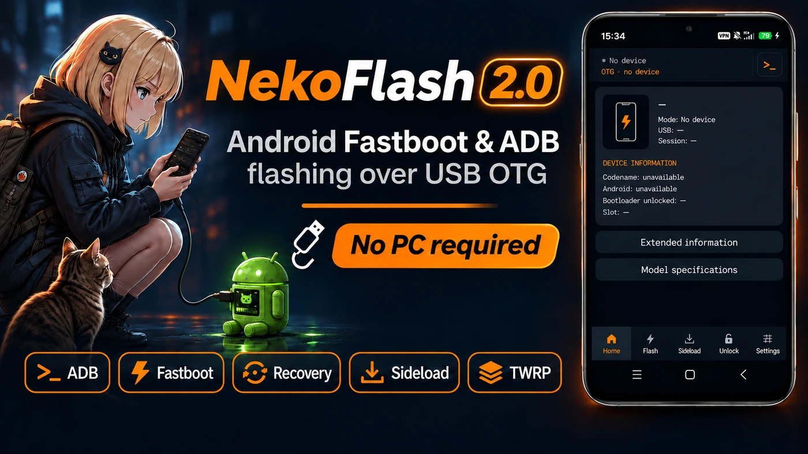
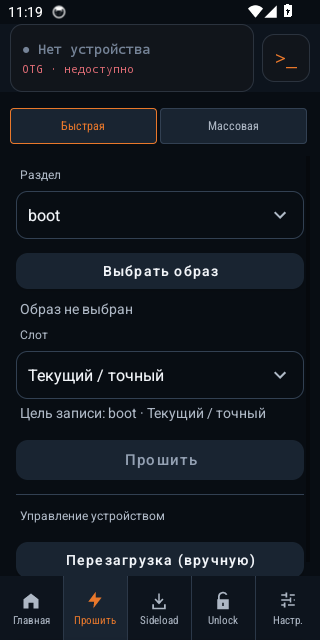
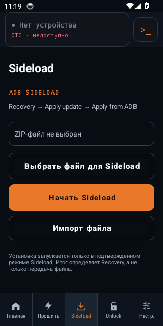
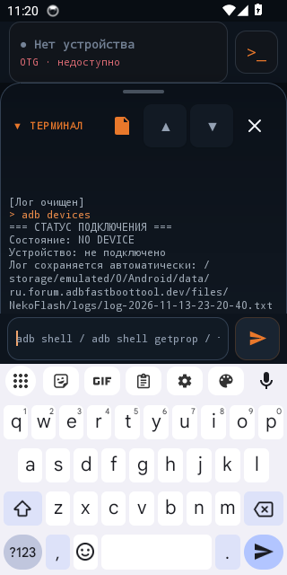

# NekoFlash 2.0

<p align="center"><a href="https://nekoflash.ncorror.chatgpt.site/ru/"></a></p>

<p align="center"><strong>ADB · Fastboot · Recovery · Sideload</strong><br>Управляй одним Android-телефоном с другого через USB OTG.</p>

<p align="center">
  <a href="https://github.com/Ncorror/NekoFlash-2.0/releases/download/v6.0.0-alpha12/NekoFlash-6.0.0-alpha12.apk"></a>
  <a href="https://github.com/Ncorror/NekoFlash-2.0/releases/download/v6.0.0-alpha12/NekoFlash-6.0.0-alpha12.apk.sha256"></a>
  <a href="https://github.com/Ncorror/NekoFlash-2.0/releases"></a>
</p>
<p align="center">
  <a href="https://nekoflash.ncorror.chatgpt.site/ru/"></a>
  <a href="https://t.me/+NR_FiUmvXlViOTUy"></a>
  <a href="https://nekoflash.ncorror.chatgpt.site/ru/guides/"></a>
</p>

<p align="center">Android 8.0+ · USB Host / OTG · Без root на телефоне-хосте<br><a href="README.md">English</a> · <strong>Русский</strong></p>

**Актуальный подписанный релиз:** [6.0.0-alpha12](https://github.com/Ncorror/NekoFlash-2.0/releases/tag/v6.0.0-alpha12) · versionCode **235** · [APK, 4,6 МиБ](https://github.com/Ncorror/NekoFlash-2.0/releases/download/v6.0.0-alpha12/NekoFlash-6.0.0-alpha12.apk)

NekoFlash превращает Android-телефон или планшет в хост для ADB и Fastboot. Прошивай совместимые образы, отправляй ZIP через Recovery, устанавливай APK, передавай файлы и выполняй команды прямо с телефона. Приложение сохраняет полные журналы операций и поддерживает работу с Mi Account и разблокировкой загрузчика Xiaomi.

## Подключение в три шага

1. **Установи APK на телефон-хост.** Нажми оранжевую кнопку скачивания выше и разреши установку из браузера или файлового менеджера, когда Android попросит.
2. **Подключи второй телефон через USB OTG.** Используй кабель или переходник с передачей данных и разреши NekoFlash доступ к USB-устройству.
3. **Выбери режим на втором телефоне.** Для ADB включи USB-отладку и подтверди RSA-запрос. Для Fastboot загрузи устройство в bootloader. Для Sideload включи ADB Sideload в Recovery.

[Помощь с подключением](https://nekoflash.ncorror.chatgpt.site/ru/help/#start) · [Как выбрать способ прошивки](https://nekoflash.ncorror.chatgpt.site/ru/guides/flash-android-without-pc/)

## Возможности

| Инструмент | Что доступно |
| --- | --- |
| **ADB** | Терминал, установка APK, Push/Pull и диагностика устройства. |
| **Fastboot** | Quick Flash, очередь образов Mass Flash, информация о разделах и прямые команды. |
| **Recovery / Sideload** | Выбор и очистка ZIP; передача запускается отдельной кнопкой. |
| **Xiaomi** | Вход в Mi Account, управление сессией и сценарий разблокировки загрузчика. |
| **Передача файлов** | Продолжение большого Pull с контрольных точек и итоговая сверка SHA-256. |
| **Центр операций** | Состояние операций и полный экспорт диагностических данных. |

Root на телефоне-хосте не требуется. Операции на втором устройстве зависят от его режима, состояния загрузчика и схемы разделов. NekoFlash поддерживает устройства без A/B-слотов и не предполагает, что слоты есть у всех.

**Статус Xiaomi Unlock:** вход в Mi Account и обнаружение Fastboot проверены. После переписывания кода полная разблокировка ещё требует повторного сквозного теста на заблокированном устройстве. Разрешения аккаунта и срок ожидания определяет Xiaomi. [Актуальная инструкция](https://nekoflash.ncorror.chatgpt.site/ru/guides/xiaomi-unlock-without-pc/).

## Интерфейс

<p align="center">
  <a href="https://nekoflash.ncorror.chatgpt.site/ru/#inside"></a>
  <a href="https://nekoflash.ncorror.chatgpt.site/ru/#inside"></a>
  <a href="https://nekoflash.ncorror.chatgpt.site/ru/#inside"></a>
</p>

Реальные снимки **alpha12 с русской локализацией**. [Открыть галерею на сайте](https://nekoflash.ncorror.chatgpt.site/ru/#inside).

## Руководства

- [Прошить Android без компьютера](https://nekoflash.ncorror.chatgpt.site/ru/guides/flash-android-without-pc/) — выбор между Fastboot-образом, Recovery ZIP и установкой Recovery.
- [ADB с одного Android-телефона на другой](https://nekoflash.ncorror.chatgpt.site/ru/guides/adb-without-pc/) — подключение, авторизация, терминал, установка APK и передача файлов.
- [Fastboot с телефона](https://nekoflash.ncorror.chatgpt.site/ru/guides/fastboot-from-android/) — определение устройства и проверка разделов перед операцией.
- [Установить Recovery, TWRP или OrangeFox](https://nekoflash.ncorror.chatgpt.site/ru/guides/flash-recovery-twrp/) — выбор образа под точную модель и схему разделов.
- [Отправить ZIP через ADB Sideload](https://nekoflash.ncorror.chatgpt.site/ru/guides/adb-sideload/) — подготовка Recovery и отдельный запуск передачи.
- [Разблокировка загрузчика Xiaomi / Redmi / POCO](https://nekoflash.ncorror.chatgpt.site/ru/guides/xiaomi-unlock-without-pc/) — требования аккаунта и текущее состояние проверки.

## Подлинность релиза

Скачивай подписанный публичный APK из [GitHub Releases](https://github.com/Ncorror/NekoFlash-2.0/releases/latest). Кнопка **SHA-256** загружает файл с контрольной суммой напрямую.

<details>
<summary>Контрольная сумма APK и состав релиза</summary>

SHA-256 файла `NekoFlash-6.0.0-alpha12.apk`:

```text
f5013cb895d11f7c42272075eb384e0b0bbc9d1fa3d537321504fbd01499e53b
```

Релиз содержит подписанный APK, файл `.sha256` и `filesystem-tools-source.tar.gz` — обязательные соответствующие исходники встроенных инструментов файловых систем. Debug/test-артефакты из Actions публикуются отдельно от подписанного релиза.

</details>

<details>
<summary>Проверки и известные особенности устройств</summary>

Релиз alpha12 прошёл **409 JVM-тестов**, **по 29 тестов установленного приложения на Android API 26 и 34**, независимую проверку ext4/F2FS и Android Lint. Аппаратные результаты относятся к принятой кампании alpha11; отдельную новую серию физических тестов alpha12 не заявляем.

- **POCO X3 Pro / vayu:** Fastboot format/wipe и последующая загрузка Android — FIELD PASS.
- **X3 Pro host → X3 Pro target:** повторные Pull/Push 128 МиБ с совпадающим SHA-256 — FIELD PASS.
- **Recovery/Sideload, Mass Flash, переходы ADB/Fastboot и терминал с поворотом:** принятые аппаратные результаты на документированных связках.
- **POCO F7 / onyx как хост:** остаются плавающие ошибки долгого входящего USB-трафика; продолжение Pull сохраняет завершённые контрольные точки.
- Ранее через NekoFlash разблокировали **POCO X3 Pro, POCO F5 и POCO X7 Pro**. Переписанный сценарий разблокировки ждёт повторного полного аппаратного теста.

[Текущий статус](docs/STATUS.md) · [Аппаратные испытания](docs/HARDWARE_VALIDATION.md) · [Проблемы USB](docs/USB_CONNECTION_TROUBLESHOOTING.md)

</details>

## Помощь, обратная связь и участие

Обсуждение — в [Telegram](https://t.me/+NR_FiUmvXlViOTUy). Ошибку можно [оформить на GitHub](https://github.com/Ncorror/NekoFlash-2.0/issues): укажи модели обоих телефонов, версии Android/прошивки и NekoFlash, шаги воспроизведения и точный результат. При необходимости приложи штатный диагностический ZIP; исходные журналы сохраняются полностью.

Для разработки и проверки начни с [указателя документации](docs/README.md) и [текущего статуса](docs/STATUS.md). [Политика восстановления](docs/PROFESSIONAL_RECOVERY_POLICY.md) · [Безопасность](docs/SECURITY.md) · [Конфиденциальность](PRIVACY.md).

Автор и разработчик — [Ncorror](https://github.com/Ncorror). Участник проекта — [IQ-HARRY7](https://github.com/IQ-HARRY7).

[Apache 2.0](LICENSE) · [Условия использования графики](ASSETS_LICENSE.md) · [Сторонние компоненты](THIRD_PARTY_NOTICES.md) · [История изменений](CHANGELOG.md)
