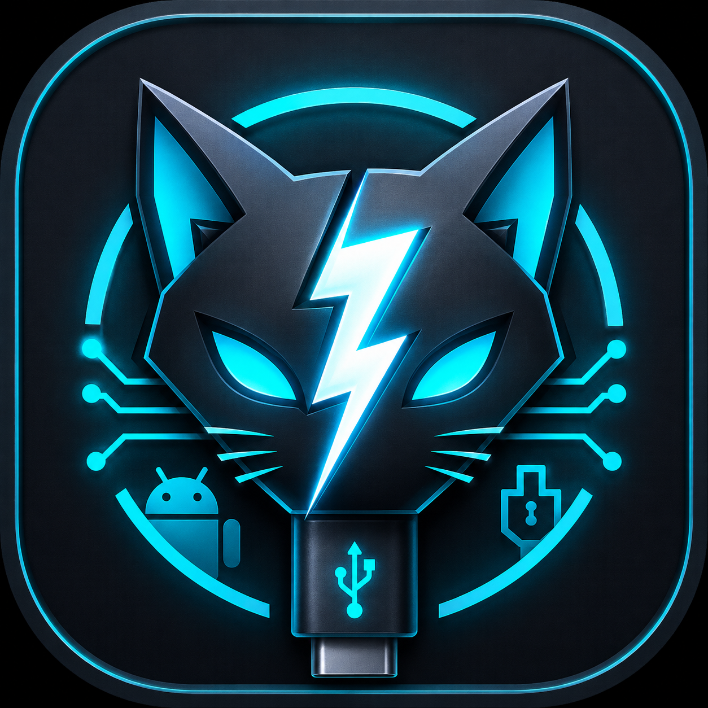

# NekoFlash 2.0

NekoFlash позволяет использовать один Android-телефон как USB-host для второго и работать с ADB, Fastboot, Recovery/Sideload, диагностикой и Xiaomi account/unlock без ПК.

**Последний подписанный релиз:** [v6.0.0-alpha11](https://github.com/Ncorror/NekoFlash-2.0/releases/tag/v6.0.0-alpha11) · versionCode 234  
**SHA-256 релизного APK:** `dfd7648d1b786b1072c0eec850d190fa472059c79b5373b26a67f1392a5c0135`

Русский · [English](README.md)

## Текущее состояние

Аппаратная и релизная кампания alpha11 завершена. Подписанный релиз прошёл защищённый release workflow, проверку постоянного сертификата и exact-SHA CI. Текущий `main` уже содержит послерелизные изменения и не является тем же самым исходником, что опубликованный подписанный tag.

Основные аппаратные результаты:

- Fastboot format/wipe на разблокированном POCO X3 Pro `vayu`: `format userdata`, `fastboot -w`, metadata/cache, reboot и загрузка до первоначальной настройки Android — **FIELD PASS**.
- Контроль ADB на POCO X3 Pro host → POCO X3 Pro target: Pull `framework.jar` и повторные Pull/Push 128 МиБ с совпадающим SHA-256 — **FIELD PASS**.
- POCO F7 / `onyx` остаётся отдельным плавающим случаем USB-host receive. Большой Pull использует устойчивые checkpoint и итоговую проверку SHA-256; повреждённый USB-пакет не повторяется молча.
- Recovery/Sideload, Mass Flash, переходы Fastboot, Xiaomi sign-in, выбор/очистка ZIP и терминал/поворот имеют принятые аппаратные доказательства на протестированных связках.

См. [текущий статус](docs/STATUS.md) и [hardware validation](docs/HARDWARE_VALIDATION.md).

## Скачать

Для обычной установки используй [GitHub Releases](https://github.com/Ncorror/NekoFlash-2.0/releases/latest).

В публичном Release намеренно остаются только:
- APK;
- его SHA-256;
- `filesystem-tools-source.tar.gz` — обязательный corresponding source для встроенных filesystem tools.

Debug/test artifacts из Actions не являются production-релизом.

## Возможности

- ADB shell, install, push/pull и диагностика.
- Quick Flash, Mass Flash и прямые Fastboot-команды.
- Recovery ADB Sideload: выбор ZIP ничего не прошивает, запуск выполняется отдельным явным действием.
- Xiaomi account/session и unlock workflow.
- Operation Center и полный diagnostic evidence export.
- Host-side генерация ext4/F2FS для поддерживаемых Fastboot format.
- Большой Pull с checkpoint/resume и финальной сверкой SHA-256.

## Политика безопасности

NekoFlash — профессиональный инструмент. Сырые диагностические данные и прямой доступ к ADB/Fastboot сохраняются. При этом приложение не делает скрытый повтор неоднозначной разрушительной Fastboot-записи или повреждённого ADB-пакета.

Raw diagnostics могут содержать идентификаторы, команды и пути. Sanitized/shareable export создаётся отдельно и не меняет исходные журналы. См. [Privacy](PRIVACY.md), [Security](docs/SECURITY.md) и [Professional recovery policy](docs/PROFESSIONAL_RECOVERY_POLICY.md).

## Документация

Начинай с [docs/README.md](docs/README.md).

Главные документы:
- [Status](docs/STATUS.md)
- [Послерелизный аудит](docs/AUDIT_2026-11-13.md)
- [Hardware validation](docs/HARDWARE_VALIDATION.md)
- [USB troubleshooting](docs/USB_CONNECTION_TROUBLESHOOTING.md)
- [Repository/release security](docs/REPOSITORY_SECURITY.md)
- [Legal review](docs/LEGAL_REVIEW.md)
- [Third-party notices](THIRD_PARTY_NOTICES.md)

Старые REV/audit-срезы сохраняются в Git history, а не лежат рядом как конкурирующие актуальные инструкции.

## Проект

Автор и разработчик — [Ncorror](https://github.com/Ncorror). Участник проекта — [IQ-HARRY7](https://github.com/IQ-HARRY7).

[Apache 2.0](LICENSE) · [Artwork terms](ASSETS_LICENSE.md) · [Changelog](CHANGELOG.md)
