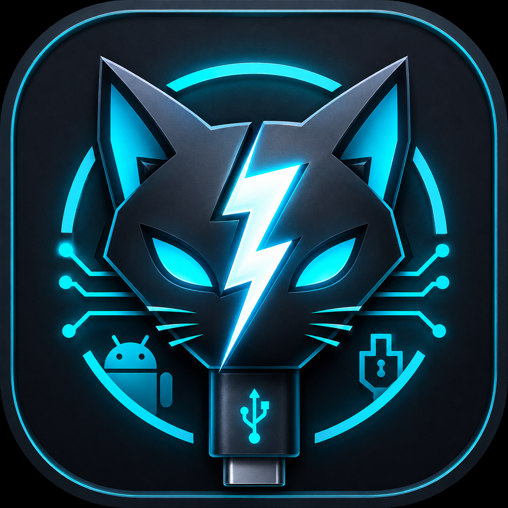

# NekoFlash 2.0 — Full Design Legacy Audit

### Comprehensive audit of approved design decisions compared against original legacy source

English&nbsp;&nbsp;|&nbsp;&nbsp;[Русский](#русская-версия--russian-version)

## Full Design Legacy Audit

**Date:** October 9, 2026  
**State:** Static audit of design specifications, WITHOUT modifying source code, USB sessions, APKs, or GitHub repositories.  
**Baseline:** `NekoFlash-main-legacy.zip`, **SHA-256 `74fe6f49fe466b15a2cd5b36e141c208823b4ef9e7a42ea96e0d5647b9c9d5b3`**, `versionName=6.0.0-alpha11`, `versionCode=234`, `applicationId=ru.forum.adbfastboottool` (`app/build.gradle:29-33`). This is **not NekoFlash-Pro** and not an experimental fork.

---

## 0. Status Classification Definitions

- **APPROVED:** The user explicitly affirmed this design choice. Does NOT mean "implemented in APK".
- **IN LEGACY:** Capability or mechanism is present in original code. Does NOT mean it matches new UX without adaptation.
- **FINDING:** Discrepancy, technical hazard, missing evidence, or unaddressed requirement requiring alignment.
- **NOT AGREED:** Requires explicit user determination; must not be implemented unilaterally.
- **VERIFY:** Demands automated or hardware regression tests; static review alone is insufficient.

---

## 1. Executive Summary & Top Findings

**Summary:** The design consensus establishes shell behavior, device overview cards, USB status reporting, and the Operation Center. Essential tested transport mechanics from legacy are preserved. **No new UI screens or background coordinators were merged into the legacy baseline during this phase.**

**Top Audit Findings:**
1. **[P0 / UX]** Navigation contains five tabs (`Home`, `Flash`, `ADB`, `Unlock`, `Settings`), but opening the full-screen terminal needed clear definition.
2. **[P0 / Architecture]** Legacy operations run inside `viewModelScope` (`DeviceViewModel.kt:1604`), while `FlashOperationService` mostly supports foreground notifications. ViewModel destruction risks interrupting long operations.
3. **[P0 / Transport]** Native USBFS enforces a **hard 90-second timeout** (`FastbootProtocol.kt:1442-1472`, `native_usbfs.cpp`), which risks aborting slow but functional large image writes.
4. **[P0 / Logs]** Legacy storage rotates segments (`DiagnosticLogStore.kt`: caps at 30 files / 64 MiB), and sanitized export caps at 64 MiB, conflicting with complete lossless logging requirements.
5. **[P1 / Outcome]** Successful Recovery Sideloads on POCO X3 Pro record `verificationPending=3` without updating the operation state to confirmed success (`DeviceViewModel.kt:1409-1450`).
6. **[P1 / Multi-device]** `UsbDeviceInspector.selectModeSwitchCandidate()` requires a single device candidate. Multiple attached devices require explicit selection.
7. **[P1 / Resources]** Legacy uses `FLAG_KEEP_SCREEN_ON` and automatic brightness reduction (`MainActivity.kt:300-347`).
8. **[P1 / Framing Limits]** Fastboot `download` uses a 32-bit length header, bounding single payload transfers to 4 GiB (`FastbootProtocol.kt:913-925`).

---

## 2. Inventory of Approved Design Decisions

| Functional Area | Approved UX Specification | Legacy Baseline Anchor | Audit Finding |
|---|---|---|---|
| Welcome | Retain original artwork, full-screen on cold launch, single orange "Enter NekoFlash" button. No mandatory storage gates. | `drawable-nodpi/bg_welcome.jpg`, `WelcomeActivity.kt` | **APPROVED.** Remove gates, preserve artwork, ensure window insets. |
| USB Status Bar | Persistent color strip with auto-detected mode: ADB System/Recovery/Sideload, Fastboot/Fastbootd, unknown, error. Tapping opens sheet with VID/PID, interface, diagnostics. | `ConnectionModeUiPolicy.kt`, `UsbDeviceInspector.kt`, `UsbSessionSnapshot.kt` | **APPROVED.** No manual mode overriding; unknown modes rendered accurately. |
| Navigation | Exactly five tabs: Home, Flash, ADB/Sideload, Unlock, Settings; handles window insets. | `activity_main.xml`, `TabController.kt` | **APPROVED.** Full-screen terminal accessible via header icon. |
| Home Tab | Pure device overview; no action buttons, persistent task centers, or history on Home. | `page_home.xml` | **APPROVED.** Legacy Operation Center card removed from Home. |
| Device Card | Left device photo; model + key specs on right; codename, Android version, bootloader, slot below. Two expandable cards: "Advanced Info" and "Model Specs". | `DeviceViewModel` diagnostics & inventory, getprop/getvar | **APPROVED.** Catalog data source required. |
| Terminal | Full workspace view, command input/paste, PTY for `adb shell`, clean IME handling. Terminal commands bypass Operation Center. | `AdbProtocol.kt`, `MainActivity.kt`, `ConsoleDockController.kt` | **APPROVED.** Clean entry next to USB status bar. |
| Operation Center | Contextual popup for long GUI tasks; detailed scrolling logs (100–120dp); real progress steps. | `DeviceViewModel.OperationProgress`, `NativeTransferProgress` | **APPROVED.** Presentation layer only; does not own USB transport. |
| Floating Indicator | Compact pill above bottom navigation showing percentage or indeterminate progress. | Legacy live operation strip + Home Center | **APPROVED.** Unified visual state across all tabs. |
| Operation Queue | Prompts "Queue" or "Cancel" when USB is busy; single USB owner; sequential execution. | `DeviceViewModel.startOperation` busy checks | **APPROVED.** Requires durable background coordinator. |
| Mass Flash | Sequential execution in visible order; halts on first error; no auto-retry or continue-on-error. | `runFlashQueue()` | **APPROVED.** UI overhauled to clean list. |
| USB Recovery | Differentiate normal mode transitions, ADB disconnection, Fastboot broken sessions, Native USBFS drain. Retain `USBDEVFS_RESET`. | `UsbTransportShutdownPolicy`, `NativeUsbfsBackend` | **APPROVED.** Reconnecting is not assumed to mean success. |
| Outcome States | SUCCESS, FAILED, CANCELLED, VERIFY_PENDING; logs and reports preserved after closing window. | `DeviceViewModel.OperationOutcomeKind` | **APPROVED.** Sideload and unlock outcomes strictly verified. |

---

## 3. Invariants — Forbidden to Break

- **Single USB Transport Owner:** GUI and terminal cannot execute concurrent USB mutations.
- **Native USBFS URB Lifecycle:** Strict pending URB cancellation/drain/poison rules; `USBDEVFS_RESET` restricted to narrow recovery paths.
- **No Auto-Retry on Ambiguous Writes:** Never automatically retry incomplete Fastboot DATA transfers.
- **Protocol Fidelity:** Preserve ADB `shell_v2`, RSA authentication, and exact bootloader response interpretations.
- **Hardware Topologies:** Respect actual partition configurations (`has-slot`, A-only, A/B). Never guess slots.
- **Lossless Logging:** Logs and reports must not be truncated silently; authentication credentials must not leak.
- **Visual Heritage:** Maintain original Welcome artwork, dark theme with signature orange accent, and clean professional styling.

---

## Русская версия / Russian Version

# NekoFlash 2.0 — полный аудит утверждённого проектирования и сверка с оригинальным legacy

**Дата:** 9 октября 2026 г.  
**Состояние:** аудит проектных решений, БЕЗ изменений исходного кода, USB-сессий, APK и GitHub.  
**Основа:** исходный `NekoFlash-main-legacy.zip`, **SHA-256 `74fe6f49fe466b15a2cd5b36e141c208823b4ef9e7a42ea96e0d5647b9c9d5b3`**, `versionName=6.0.0-alpha11`, `versionCode=234`, `applicationId=ru.forum.adbfastboottool` (`app/build.gradle:29-33`).

## 0. Что означает статус в этом отчёте

- **УТВЕРЖДЕНО** — пользователь явно принял проектное решение. НЕ означает «реализовано в APK».
- **ЕСТЬ В LEGACY** — функция либо механизм обнаружен в коде/документах оригинала. НЕ означает, что он соответствует новому UX без адаптации.
- **НАХОДКА** — отличие, технический риск, недостаток доказательств или упущенная функция для обсуждения.
- **НЕ СОГЛАСОВАНО** — необходимо отдельное решение пользователя, не внедрять самовольно.
- **ПРОВЕРИТЬ** — требуется автоматический или аппаратный регрессионный тест; статический анализ не доказывает работоспособность новой реализации.

## 1. Краткий итог

**Основной результат:** Зафиксирована согласованная концепция оболочки, страницы устройства, USB-статуса и Центра операций. Важная проверенная транспортная логика legacy сохранена как обязательная основа. **Ни один новый экран, попап или фоновой координатор не был внедрён в оригинальный ZIP на этом этапе проектирования.**

## 2. Инвентаризация утверждённого дизайна

| Раздел | Утверждённое поведение | Legacy-опора | Итог проверки |
|---|---|---|---|
| Welcome | Неизменное исходное artwork, полноэкранный экран на холодном старте, название и одна оранжевая «Войти в NekoFlash». Без обязательного storage gate. | `drawable-nodpi/bg_welcome.jpg`, `WelcomeActivity.kt` | **УТВЕРЖДЕНО.** |
| Верхний USB-статус | Постоянная цветная панель с автоматически определяемым режимом. | `ConnectionModeUiPolicy.kt`, `UsbDeviceInspector.kt` | **УТВЕРЖДЕНО.** |
| Нижняя навигация | Ровно пять пунктов: Главная / Прошивка / ADB / Unlock / Настройки. | `activity_main.xml`, `TabController.kt` | **УТВЕРЖДЕНО.** |
| Главная | Только информация об устройстве; никаких рабочих кнопок. | `page_home.xml` | **УТВЕРЖДЕНО.** |
| Карточка устройства | Фото слева; название + 2–3 короткие спецификации справа; ниже codename, Android, bootloader, slot. | `DeviceViewModel` diagnostics и inventory | **УТВЕРЖДЕНО.** |
| Терминал | Профессиональный полный рабочий экран. | `AdbProtocol.kt`, `MainActivity.kt` | **УТВЕРЖДЕНО.** |
| Центр операций | Контекстные всплывающие окна для GUI-длительных задач. | `DeviceViewModel.OperationProgress` | **УТВЕРЖДЕНО.** |
| Массовая прошивка | Последовательно, порядок заранее виден, первая ошибка останавливает всю пачку. | `runFlashQueue()` | **УТВЕРЖДЕНО.** |

## 3. Инварианты, запрещено ломать при миграции

- Единственный владелец физического USB transport; GUI и терминал не могут независимо запускать конкурентные операции.
- Native USBFS pending URB cancel/drain/poison semantics; `USBDEVFS_RESET` только в прежнем ограниченном recovery-path.
- Никакой auto-retry после ambiguous Fastboot DATA/flash; нельзя подменять «передано 100%» на «раздел записан».
- ADB `shell_v2` и логика `CLSE`/RSA key/auth; Recovery/Sideload verification; сохранение точной семантики ответа загрузчика.
- Фактическая топология разделов, `has-slot`, A-only и A/B; не угадывать слот.
- Логи/отчёты не усекаются ради удобства UI; секреты авторизации не распространяются.
- Оригинальное Welcome artwork/брендинг не изменять; тёмная тема/оранжевый акцент.
