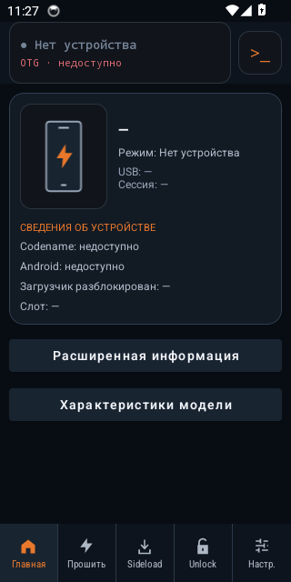
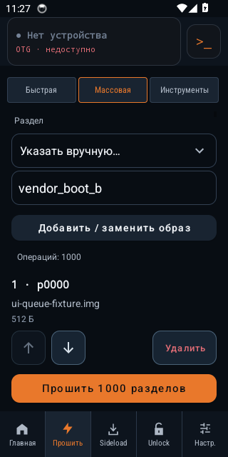
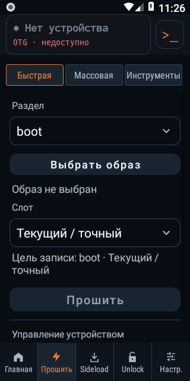
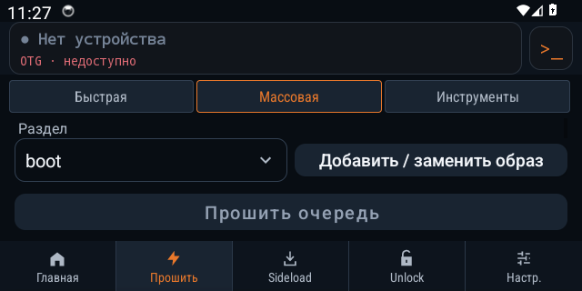

# NekoFlash 2.0 — REV25: полировка интерфейса и длинная очередь

Дата: **28–29 октября 2026**, Europe/Moscow. Репозиторий: **Ncorror/NekoFlash-2.0**.
База REV24: `de80e5dde69e0316fb8fab4850b6bfca830a639d`.
Проверенный код: `06b923f3977c8ad14f143a6af63d91b9cc129318`.
Ветка: `work/rev25-ui-polish-20261028`.
[Draft PR #12](https://github.com/Ncorror/NekoFlash-2.0/pull/12). Серия ещё не объединена в `main`; production Release не выпускался.

## Что изменилось

| Область | Результат |
|---|---|
| Пять вкладок | Вместо эмодзи — единые векторные иконки; иконка и подпись подсвечиваются вместе. Компактный системный шрифт сохраняет целые подписи при масштабе 130%. Сохранены Главная, Прошивка, Sideload, Unlock и Настройки |
| Прошивка | Переключатель трёх разделов закреплён сверху; подписи не разрываются посреди слова; Quick и Tools имеют собственную прокрутку |
| Массовая прошивка — R10 | RecyclerView создаёт видимые строки, а DiffUtil обновляет изменившиеся элементы. Нет ограничения количества заданий |
| Строка очереди | Номер, точный раздел, полное имя и размер файла; стрелки вверх/вниз и удаление. Обработчик получает текущую позицию строки после перестановки; перемещённая строка остаётся в видимой области |
| Запуск очереди | Закреплённая кнопка «Прошить N разделов» с RU/EN множественными формами; ожидание проверки источника показано отдельно |
| Пустая очередь | Подсказка объясняет выбор раздела и добавление образа; запуск отключён |
| Восстановление | Форма сохраняется даже после ухода за пределы экрана; RecyclerView восстанавливает позицию прокрутки |
| Главная | Нейтральная иллюстрация устройства вместо launcher-иконки, более крупные подписи. Неизвестная модель не подменяется данными выдуманного телефона |
| Unlock | Кнопки переведены на MaterialButton с согласованными отступами, скруглением и состояниями. Проверки аккаунта/блокировки и действия сохранены |
| Горизонтальный режим | Компактные USB-панель, навигация и отступы; раздел и выбор образа стоят рядом и остаются полностью видимыми при 130% шрифте |

R10 закрывается в части отображения очереди. Это новый вспомогательный UI-класс над
существующей моделью и исполнителем. Полной перерисовки LinearLayout больше нет;
это не переписывание USB/ADB/Fastboot. Порядок, замена точного раздела, остановка
при ошибке и ручной запуск операции остаются прежними.

## Проверки и реальные снимки

[CI 40864382692](https://github.com/Ncorror/NekoFlash-2.0/actions/runs/40864382692) — **SUCCESS**: сборка, API 26 и API 34. Проверки относятся к указанному выше коммиту кода; последующее обновление README, отчёта и снимков меняет только документацию.

| Проверка | Результат |
|---|---|
| JVM / Robolectric | **234 теста**, 0 failures/errors/skipped |
| Android API 26 | **13 тестов**, PASS |
| Android API 34 | **13 тестов**, PASS |
| Android Lint | **0 ошибок, 45 предупреждений**: UnusedResources 32, UseKtx 6, Autofill 4, UsableSpace 2, PluralsCandidate 1 |
| Native | ASan/UBSan — PASS |
| APK | 8 встроенных ELF для 4 ABI; PIE и выравнивание 16 KiB — PASS |
| ext4/F2FS | 8 образов восстановлены из 50 sparse-частей; SHA-256 совпадает, fsck=0 |
| Интерфейс | 54 PNG: по 23 новых снимка интерфейса и 4 состояния источников на каждом API |
| Сверка с архивом | CRC PASS; проверены SHA-256 всех 162 исходных файлов |

Новые инструментальные сценарии проверяют все пять вкладок и три раздела
прошивки на русском языке, обычный шрифт и масштаб **130%**, портретную и
горизонтальную ориентацию. Очередь из **1000 тестовых разделов** проверяется
на создание ограниченного количества видимых View, перестановку, удаление,
восстановление формы и прокрутки после пересоздания Activity. Это проверка
интерфейса; кнопка прошивки не нажимается и USB-записи не выполняются.

Просмотрены все **54** итоговых снимка. Пять вкладок и три раздела прошивки
сняты на русском: портрет при **100% и 130%**, горизонтальный режим при **130%**.
Подписи навигации и разделов сохраняются в одну строку; поля массовой прошивки
и кнопка добавления целиком доступны в горизонтальном режиме. Длинные страницы
прокручиваются под закреплённой навигацией. Отдельные четыре сценария источников
на каждом API сняты на английском и показывают восстановление, недоступный файл,
список разделов и SAF-очередь. Все PNG проверены на целостность.

Ниже — четыре исходных снимка установленного APK без ретуши:

| Главная, API 34, 100% | Очередь 1000, API 34, 100% |
|---|---|
|  |  |

| Прошивка, API 26, 130% | Горизонтальная форма, API 34, 130% |
|---|---|
|  |  |

Полный набор и логи: [API 26](https://github.com/Ncorror/NekoFlash-2.0/actions/runs/40864382692/artifacts/12893935834),
[API 34](https://github.com/Ncorror/NekoFlash-2.0/actions/runs/40864382692/artifacts/12893332839),
[JVM/lint/build](https://github.com/Ncorror/NekoFlash-2.0/actions/runs/40864382692/artifacts/12892798884).
Срок хранения этих CI-артефактов — **до 28 ноября 2026**; четыре выбранных PNG
сохранены непосредственно в репозитории.

При проверке исправлены падение формы очереди до назначения LayoutManager,
обрезание навигации и полей в горизонтальном режиме, а также уход перемещённой
строки за границу списка. Конструктор формы и геометрия всей оболочки проверяются
отдельными Robolectric-тестами на API 26/34. Инструментальный тест дополнительно
проверяет полную видимость полей, переносы подписей, перестановку строк и
восстановление. Номер запроса не позволяет устаревшему diff прокрутить список
после более позднего действия. Тесты явно устанавливают и проверяют русский язык,
в том числе через LocaleManager до создания Activity на API 33+.

Screenshot-helper теперь ждёт отрисовку кадров и стабилизацию интерфейса.
CI собирает имеющиеся снимки и при неполном наборе, но отсутствие обязательного
снимка по-прежнему проваливает проверку. Результаты ниже относятся к итоговому коду.

## Сборка

[Скачать архив с DEV APK и соответствующими исходниками mkfs](https://github.com/Ncorror/NekoFlash-2.0/actions/runs/40864382692/artifacts/12892739298). Артефакт CI хранится **до 12 ноября 2026** (дата по Москве).

| Файл | Размер, байт | SHA-256 |
|---|---:|---|
| `NekoFlash-6.0.0-alpha11-debug.apk` | 10 851 935 | `cd147b8bfb8319bf69ed19cf336beb1a1297df1fb4eab62d278ba4a79d1ded12` |
| `filesystem-tools-source.tar.gz` | 9 887 434 | `43673426ba6d449b1a3fadd64e04081dc75c261737e225e18acb021a66b232f7` |

Метаданные APK и BUILD_ID проверены: код соответствует коммиту `06b923f`;
тестовый provider в APK приложения отсутствует. Manifest, build-script,
лицензии и исходные tar-архивы mkfs сверены с закреплёнными входами репозитория.

Версия остаётся `6.0.0-alpha11-dev`, versionCode 234; пакет
`ru.forum.adbfastboottool.dev`. Ревизия различается BUILD_ID.
С APK сохраняются соответствующие исходники и лицензии встроенных ext4/F2FS-генераторов.

## Сверка с исходным архивом

[Машинный отчёт](REV25-LEGACY-COMPARISON.json) проверяет все **162** исходных файла
`NekoFlash-main-legacy.zip`, SHA-256
`74fe6f49fe466b15a2cd5b36e141c208823b4ef9e7a42ea96e0d5647b9c9d5b3`; CRC — PASS.
**128 без изменений, 34 изменены, 0 удалены** — накопленная разница всей серии.
Добавленные вспомогательные классы, ресурсы и тесты не входят в исходные 162 файла.

Относительно REV24 не изменены `native_usbfs.cpp`, `NativeUsbfsBackend`,
`AdbProtocol`, `FastbootProtocol`, `DeviceViewModel`, `FlashOperationService`,
`MiAccountClient` и `MiUnlockClient`. Совпадение исходных строк native USBFS —
98,7%, ADB — 96,2%, Fastboot — 97,9%, DeviceViewModel — 86,8%.
Совпадение строк не является показателем корректности.

**IQ-HARRY7** сохранён в Developers README.

## Что остаётся

- **R07:** отмена импорта/распаковки, учёт свободного места и очистка незавершённых файлов.
- **R06:** терминал с Gboard и второй IME на телефоне: composition/commit, вставка,
  emoji, Backspace, изменение размера и поворот.
- **R11:** состояния Главной с реальным подключённым устройством, источник фотографий
  и характеристик моделей, оставшиеся сообщения в коде. Источник каталога ещё не выбран.
- **Аппаратная матрица:** реальные SAF-grants/providers, USB/ARM, bootloader/fastbootd,
  большие образы и передача; авторизованный Mi Unlock и подтверждение результата.
- **R16/R17:** интеграция серии веток, оставшиеся lint-предупреждения, версия/SDK,
  постоянная подпись Release и проверка обновления.

Готовность остаётся **около 80%, техническая альфа** — оценка оставшегося объёма,
а не процент тестового покрытия. Полировка продвинулась и R10 устранён, но
эмуляторные снимки не подтверждают физическую совместимость и готовность выпуска.
Максимальный системный шрифт и все клавиатуры/размеры физических экранов этой
матрицей не покрыты. Реальная прошивка и разблокировка в этой ревизии не выполнялись.
